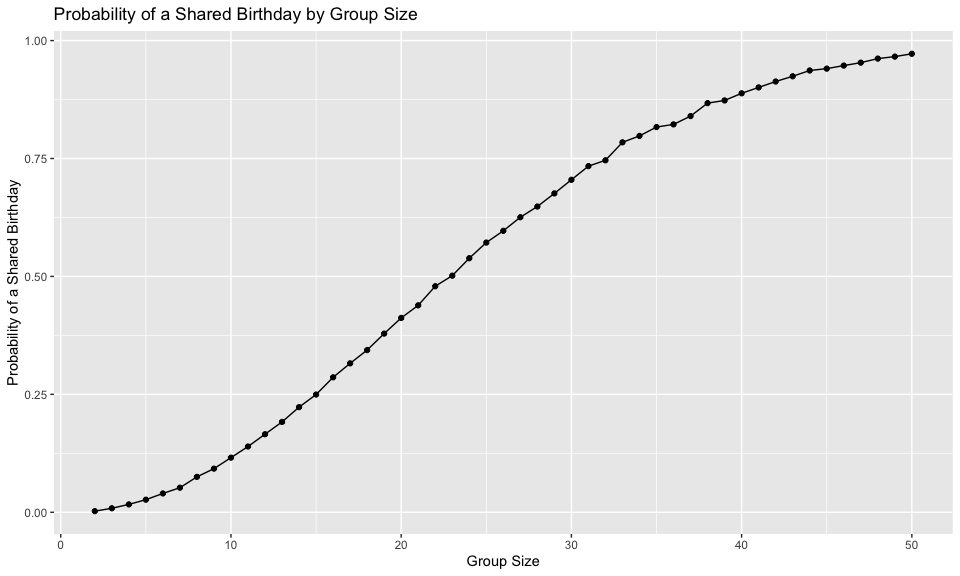
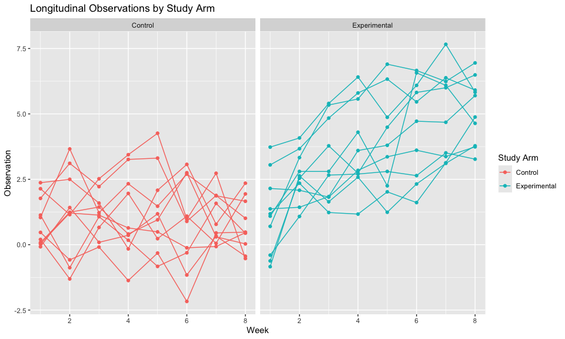
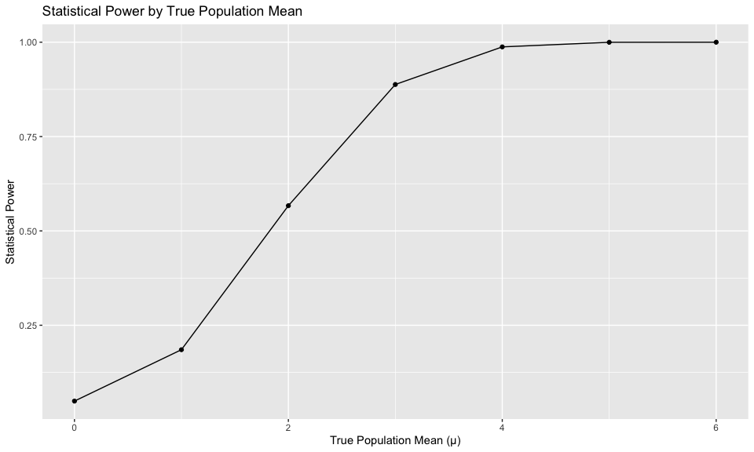
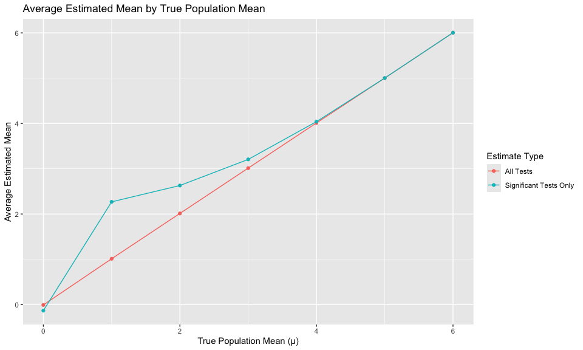

p8105_hw5_nw2614
================
Natasha Woon
2026-11-16

# Loading Packages

``` r
library(tidyverse)

knitr::opts_chunk$set(
  fig.width = 10,
  fig.height = 6,
  out.width = "100%"
)

theme_set(theme_gray())

set.seed(1)
```

# Problem 1

The function created below generates random birthdays for a group of
size `n` and checks whether any birthdays are shared:

``` r
#writing a function for a fixed group size
birthday_simulations = function(n) {
  birthdays = sample(1:365, size = n, replace = TRUE) 
  any(duplicated(birthdays))
}
```

The code below simulates a data frame using the function we created
above 10,000 times for each group size between 2 and 50.

``` r
#setting up 10,000 simulations for each group size between 2 and 50

birthday_simulations_df = 
  expand_grid(
    group_size = 2:50,
    iter = 1:10000
  ) |>
  mutate(
    shared_birthday = map(group_size, birthday_simulations)
  ) |>
  unnest(shared_birthday)

birthday_probabilities_df =
  birthday_simulations_df |>
  group_by(group_size) |>
  summarize(
    probability = mean(shared_birthday)
  )
```

The data frame created has 490,000 observations and 3 columns. The 3
columns include group size, iteration (between 1 and 10,000) and whether
or not there was a duplicate birthday (TRUE/FALSE).

``` r
# creating plot
birthday_probabilities_df |>
  ggplot(aes(x = group_size, y = probability)) +
  geom_line() +
  geom_point() +
  labs(
    title = "Probability of a Shared Birthday by Group Size",
    x = "Group Size",
    y = "Probability of a Shared Birthday"
  )
```



The probability of at least two people sharing a birthday increased as
group size increased. When there were 23 people in a group, the
probability was approximately 50%, even though there were 365 possible
birthdays. When the group size was 50, the probability increased to
around 97%. As the group size increases, there is a greater probability
that two people in the same group would share a birthday.

# Problem 2

``` r
#importing csv files
longitudinal_arms_df = 
  tibble(
    files = list.files("data"),
    path = str_c("data/", files)
  ) |>
  mutate(
    data = map(path, read_csv)
  ) |>
  unnest(data)

#tidying data
longitudinal_tidy_df = 
  longitudinal_arms_df |>
  pivot_longer(
    cols = starts_with ("week_"),
    names_to = "week",
    values_to = "observation"
  ) |>
  separate(
    files, 
    into = c("arm", "subject_id"),
    sep = "_"
  ) |>
  mutate(
    subject_id = str_replace(subject_id, ".csv", ""),
    week = as.numeric(str_replace(week, "week_", ""))
  )
```

A dataframe containing data from all participants was created. Instead
of reading in the data individually, `map()` was used to read in all the
data files. The data was then tidied into a long format.

Then, a spaghetti plot was made to show observations on each subject
over time.

``` r
#Making the Spaghetti Plot
longitudinal_tidy_df |>
  ggplot(aes(x = week, y = observation,
             group = subject_id, color = arm)) +
  geom_point() +
  geom_path() +
  facet_grid(~arm, labeller = as_labeller(c(
    con = "Control",
    exp = "Experimental"
  ))) +
  scale_color_discrete(
    labels = c("Control", "Experimental")
  ) +
  labs(
    title = "Longitudinal Observations by Study Arm",
    x = "Week",
    y = "Observation",
    color = "Study Arm"
  )
```



The Spaghetti Plot shows the longitudinal observation of subjects in the
control and experimental arms over an eight week period. Observations in
the control arm fluctuate without a clear overall trend in direction. On
the other hand, observations in the experimental arms generally increase
over time. This suggests that the experimental arms shows an upward
trend in observations compared to the relatively stable control arm.

# Problem 3

Creating a function to run a one-sample t-test using the design elements
given in the problem:

``` r
t_test_simulation = function(mu) {
  simulated_data = rnorm(n = 30, mean = mu, sd = 5)
  
  t.test(simulated_data, mu = 0) |>
    broom::tidy()
}
```

Running 5000 tests with μ = 0:

``` r
t_test_results_df = 
  tibble(
    iter = 1:5000
  ) |>
  mutate(
    results = map(iter, ~t_test_simulation(0))
  ) |>
  unnest(results)
```

Calculating how often we incorrectly reject the null hypothesis:

``` r
t_test_results_df |>
  summarize(
    proportion_significant = mean(p.value < 0.05)
  )
```

    ## # A tibble: 1 × 1
    ##   proportion_significant
    ##                    <dbl>
    ## 1                   0.05

Run 5,000 tests for each μ from 0 to 6:

``` r
t_test_power_df =
  expand_grid(
    mu = 0:6,
    iter = 1:5000
  ) |>
  mutate(
    results = map(mu, t_test_simulation)
  ) |>
  unnest(results) |>
  mutate(
    reject = p.value < 0.05
  )
```

Calculating statistical power for each μ:

``` r
t_test_power_summary_df = 
  t_test_power_df |>
  group_by(mu) |>
  summarize(
    power = mean(reject)
  )
```

Plotting the results for statistical power for each μ:

``` r
t_test_power_summary_df |>
  ggplot(aes(x = mu, y = power)) +
  geom_line() +
  geom_point() +
  labs(
    title = "Statistical Power by True Population Mean",
    x = "True Population Mean (μ)",
    y = "Statistical Power"
  )
```



In this plot, we can see that as the true population mean increases from
0 to 6, the statistical power of the one-sample t-test also increases.
When the true population mean (μ) is 0, approximately 5.3% of tests
reject the null hypothesis, which is close to the expected Type I error
rate of 5%. When the true population mean is 1, power increases to
approximately 19%, and then to approximately 56% when that true
population mean is 2. By μ = 5, power approaches 100%. As the true
population mean moves farther away from the null value of 0, the test is
more likely to reject the null hypothesis and capture a statistically
significant difference.

Calculatingand plotting the average estimates means across all tests and
average estimated means for significant tests only:

``` r
mean_estimates_combined_df =
  t_test_power_df |>
  group_by(mu) |>
  summarize(
    all_estimates = mean(estimate),
    significant_estimates = mean(estimate[reject])
  )

mean_estimates_tidy_df =
  mean_estimates_combined_df |>
  pivot_longer(
    cols = c(all_estimates, significant_estimates),
    names_to = "estimate_type",
    values_to = "mean_estimate"
  )

mean_estimates_tidy_df |>
  ggplot(aes(
    x = mu,
    y = mean_estimate,
    color = estimate_type
  )) +
  geom_line() +
  geom_point() +
  scale_color_discrete(
    labels = c("All Tests", "Significant Tests Only")
  ) +
  labs(
    title = "Average Estimated Mean by True Population Mean",
    x = "True Population Mean (μ)",
    y = "Average Estimated Mean",
    color = "Estimate Type"
  )
```



Across all simulations, the average estimated mean was very close to the
true population mean. However, when looking only at the significant
tests (p \< 0.05; blue line), the average estimated mean was higher,
particularly at smaller true population means. For example when μ = 1,
the average estimated mean was 1.01 across all simulations, compared to
2.23 among significant tests. This makes sense because when the true
population mean is closer to the null value of 0, a larger difference
between the estimated mean and the null is generally needed to reach
statistical significance. As a result, tests are more likely to be
significant when random sampling variation makes the estimated mean
appear larger than it actually is. This highlights how focusing purely
on statistically significant results can introduce selection bias and
make the true effect appear larger than it actually is. In general, this
plot shows that as the true population mean increases, the two lines
converge because nearly all tests become statistically significant.
